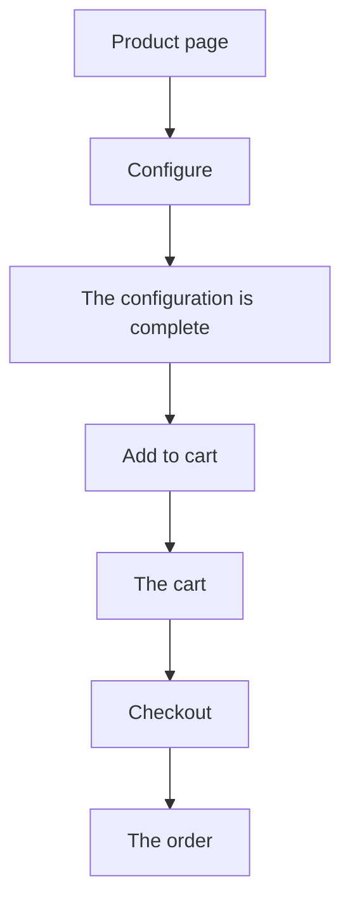
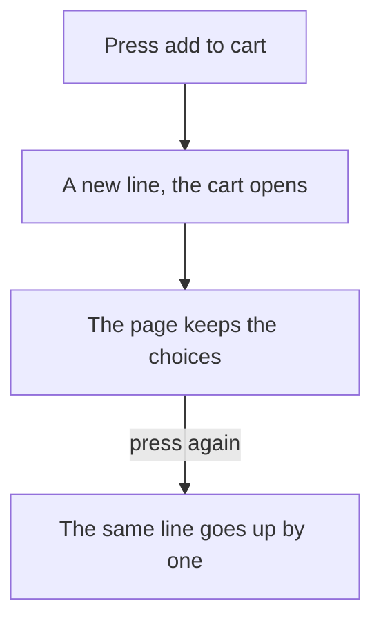
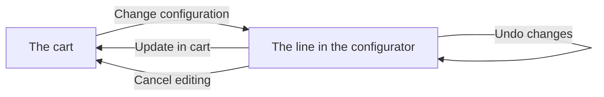
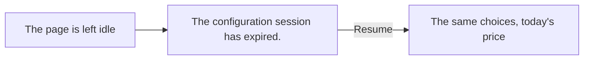
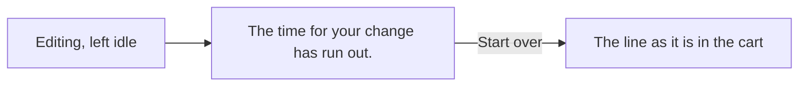
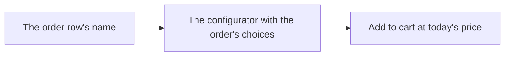

# How the configurator behaves

A configurable product is built by the buyer before it can be bought. The buyer picks options and
fills in values. The configurator works out the price and says when the configuration is complete.
The finished configuration goes into the cart as one line, and on to checkout and the order.

This page lists what the buyer meets, one case at a time. The code behind it is described in
[Product configurator](/configurator).

## Signed out and signed in

### A guest opens a configurable product

The guest sees the ordinary product page with a box saying "Configurable product" and "Sign in as a business customer to configure this product.". There is no price, no add button and no buy
button.

### A guest presses "Sign in" in that box

The sign-in panel opens.

### A guest sees a configurable product in a list

The product card shows no price, no button and no text.

### A signed-in buyer opens a configurable product

The buyer gets the configurator page. At the top, "Configure product" opens the configuration,
and a note under it says "This is a configurable product. Build your variant under Product configuration below.".

### A signed-in buyer sees a configurable product in a list

The card shows "Configure product" and "Price calculated on configuration" instead of a price, a
quantity and an add button. The button leads to the configurator, never straight to the cart.

### Ordering is off for the buyer

A configurable product's card shows no button.

### The shop is in catalogue mode

The configurator page opens, but the configuration cannot start. The page says "Sign in with a company account to configure this product.".

### The configuration is refused for the buyer

When the configurator refuses the buyer, for example a company without a customer number, the page
says "Sign in with a company account to configure this product.".

### A configurable product is on a saved list

The row says "Price calculated on configuration" instead of a price and has a "Configure product"
button to the product page. It has no quantity field.

### The saved list's total

Configurable products are not counted. A note under the total says "Products that are configured are not included".

### "Add all to cart" on a saved list

Only the ordinary products are added. The cart opens with a note: "1 product needs configuring and was not added to the cart".

### "Add all to cart" on a list of only configurable products

The button is still shown. The cart opens with only the note in it.

### The purchased products table

A configurable product is listed with a price, like any other product.

### Prices are hidden for the buyer

The configurator shows no price block, no "Base price" and no option prices.

## Configure

### The page loads

The page says "Loading the product configurator" until the form is ready. The form opens on the
product's default choices.

### The product cannot be configured

When the configurator does not know the product, or the account has no configurator, the page says
"This product cannot be configured right now.".

### The configuration fails to start

The page says "Something went wrong. Reload the page and try again.".

### The product has several sections

On a wide screen the sections are listed in a rail on the left.

### The buyer steps between sections

"Previous" and "Next" under the form step between sections, with "Section 2 of 5" between them.
They are shown only when there is more than one section.

### A section holds other sections

The section says "Choose a subsection to continue." and shows a button for each section
inside it. A nested section shows a trail above it.

### The buyer picks an option

The option is sent at once. The form is locked until the answer comes back, and the whole form may
change with it.

### The buyer types a number or a text

The value is sent when the buyer leaves the field or presses Enter.

### The buyer uses a value's plus or minus buttons

The value is sent at once.

### The buyer uses a yes/no switch or a date

The value is sent at once.

### The configuration is not complete

The button says "Required choices remain" and cannot add.

### Required choices are missing

"Required choices remaining (n)" opens a list of what is missing. Each item is a link to its
section. On a wide screen the list sits under the rail, and each section with a missing choice is
marked in the rail.

### The configurator reports an error that names no choice

The error is listed in the same place as plain text, and counted with the missing choices.

### The configuration is complete

The status says "All required choices are made", and the button says "Add to Cart".

### The configuration is not complete and nothing is listed

The status says "The configuration is not complete.".

### An option cannot be picked with the current choices

The option is shown but cannot be picked. It says "Not available with your current choices", or
the configurator's own reason when it sends one.

### A value is not available with the current choices

The field is hidden until a choice makes it available.

### A group has nothing to pick

The group says "Nothing to choose with your current choices".

### A group offers several options

The group shows the chosen option, or "Choose". Pressing it opens a side panel, "Choose {name}", with
a search field.

### A group that can be skipped has nothing chosen

The group shows "None".

### A group allows several options

The chosen options are listed. "Choose", or "Add more" once one is chosen, opens the side
panel.

### An option is set by the configuration

The option says "Set by the configuration".

### A value is set by the configuration

The field says "Set automatically".

### A value has limits

The field shows its range, for example "10–200 mm".

### A choice narrows a value's range while its section is open

The field adds "limit adjusted by an earlier choice" to its range.

### The configurator refuses an option

The form keeps the choices it had. The group says "The choice was not accepted. Try another choice.".

### The configurator refuses a value

The form keeps the choices it had. The field says "The value was not accepted. Try another value.".

### A change fails for another reason

The page says "Something went wrong. Reload the page and try again." above the form.

### The configurator sends a message about an option or a value

The message is shown at the option or the field.

### The configurator sends a message about a group

The group shows an info icon. The message opens from it.

### An option has its own quantity

When the option is picked and its group allows a quantity, the option gets a plus and minus
stepper.

### An option has a fixed quantity above one

When the option is picked and its group allows a quantity, the quantity is shown beside the
option's name.

### The buyer presses "Reset"

Every choice is dropped, and the form opens again on the defaults.

### The buyer switches market in the middle

The page says "You have changed market since you started. Choose Resume to continue with your choices at this market's prices.". "Resume" brings the choices back at the new market's prices.

## Price and specification

### The buyer shows prices without VAT

One price block sits above the specification. It reads "Price" with the price without VAT, then
"VAT", then "Total incl. VAT".

### The buyer shows prices with VAT

The price block reads "Price" with the price including VAT, then "Includes VAT". There is no third
line.

### The buyer switches between with and without VAT

Every price on the page changes side: the price block, the option prices, every specification row
and "Base price".

### The quantity is more than one

This happens only while editing a cart line of more than one. The block prices the whole quantity,
and "Price" says how many, for example "Price · 3 pcs".

### The rows when the quantity is more than one

"Base price" and the option prices stay per unit, so they do not add up to the block.

### The specification

The right column lists what has been chosen, section by section.

### "Open the specification in a larger view"

The specification opens larger, with the price block at the bottom.

### "Copy specification"

The buyer gets a text with the product's name and article number, "Quantity", "Base price", every
choice with its price, and the price block. It ends with "Indicative price. The price is confirmed in the quotation.", a line that is not on the page.

### The base price

The specification starts with a "Base price" row: what one unit costs beyond the options listed
under it, on the side the buyer has chosen.

### The options cost more than the price

There is no "Base price" row. This is decided on the price without VAT.

### "Base price" at zero with VAT

With VAT, "Base price" never goes below 0.00. Each option is rounded on its own, so the rows can
then add up to a few cents more than the price.

## Add to cart

### The buyer presses "Add to Cart"

The configuration goes into the cart as a new line at quantity one, and the cart opens. The page
keeps showing the buyer's choices.

### The buyer presses again without changing anything

The same line goes up by one, as its plus button in the cart would do. The cart opens.

### The buyer changes a choice and presses again

A new line is added at quantity one.

### The buyer changes a choice back and presses again

A new line is added at quantity one. A choice changed and changed back still counts as a change.

### The line has left the cart and the buyer presses again

A new line is added at quantity one.

### The cart already holds all the stock

The button says "Max in cart", with "Max quantity added to cart" under it.
Every line of the same article counts, configured or not.

### There is no stock

The button says "Out of stock".

### The add fails

The right column goes. The page says "The configuration could not be added to the cart." with
"Try again". Under them it shows "The configuration is complete" with "Unit price".

### "Try again" after a failed add

The same configuration is added again, without the buyer making the choices again.

### The cart does not take the line

The page says "The configuration could not be added to the cart. It may be out of stock." and
offers "Try again".

### The add is refused because the buyer is signed out

The page says "Sign in with a company account to configure this product.".

### The add is refused because the market changed

The page says "You have changed market since you started. Choose Resume to continue with your choices at this market's prices." and offers no retry.

### The choices cannot be brought back after an add

The page opens on the defaults and says "Your choices could not be loaded again. The configuration is in the cart.".

### The buyer leaves the page and comes back

The configuration starts again from the defaults.

## The cart

### A configured line

The line shows "Configured product", the line total and the price per unit.

### A configured line's article number

"Art nr." is shown before "Configured product" when the product has one.

### A configured line on sale

The regular total is shown struck through beside the line total.

### "Show configuration"

The button opens the line's choices and their prices in a panel, with the same price block as
the configurator at the bottom. It follows the buyer's VAT choice in the same way.

### The line's name

The name opens the line in the configurator, as "Change configuration" does.

### A line whose product has no page address

The name is plain text, and "Change configuration" is not shown.

### The buyer changes the quantity

Clicks in quick succession are sent as one change once they stop. The configurator prices the line
again at the new quantity.

### While a quantity change is sent

The line's controls are locked and checkout waits.

### A quantity change is refused

The line says "The quantity could not be changed. The product in the cart is unchanged." and keeps its old
quantity.

### The buyer removes the line

The line is removed, as any other line.

### The cart needs the buyer to sign in

The cart says "Sign in to see your cart" with a "Sign in" button, in place of the lines.

### The buyer signs in with lines in the cart

The lines move to the buyer's own cart. A configured line keeps its configuration.

### A configured line cannot be moved at sign-in

No line is moved. What the buyer then sees in the cart is not verified.

## Editing from the cart

### The buyer opens a line to edit it

The page opens with the line's choices. It says "Editing a product in the cart", and the
button says "Update in cart".

### "Update in cart"

The new choices replace the line's, at the line's own quantity. Until then the line keeps its old
choices.

### "Undo changes"

The line's choices come back on the page. The page is still editing the line.

### "Cancel editing"

The line stays as it was, and the cart opens.

### "Reset" while editing

The form opens on the defaults, and the page is still editing. "Update in cart" then puts
the defaults on the line.

### The line's choices cannot be opened again

The page says "The configuration cannot be opened again. Configure it from the start – the product in the cart stays as it is until you update it." and opens on the defaults. The update still replaces the same
line.

### The line cannot be opened right now

The page says "The product in the cart could not be opened right now." and offers a retry.

### The account has no configurator when a line is opened

The page says "This product cannot be configured right now." and offers no retry.

### The edit link points at a line that is not in the buyer's cart

The page says "The product is no longer in the cart." and works as an ordinary configurator.
This covers a line that is gone, another cart and another company's cart.

### The line was added in another market

The page says "The product in the cart was added in another market and cannot be changed here. It is unchanged." and offers no retry.

### The update fails

The page says "The product in the cart could not be updated. It keeps its previous choices." and
offers a retry. "Cancel editing" is still offered.

### The update fails because the line is gone

The page says "The product is no longer in the cart." and offers no retry. "Cancel editing" then
opens the configurator on the defaults.

### The update fails because the configuration is unknown

The page says "The product in the cart could not be updated. It keeps its previous choices." and
offers no retry.

## Session time

### The buyer keeps working

The configuration stays open. The page renews it shortly before it would run out, and shows
nothing about it. Clicking, typing and scrolling count as working; moving the mouse does not.

### The page is left idle on the product page

The form is replaced by "The configuration session has expired." without a click. "Resume" opens a
new configuration with the same choices, at today's price.

### The tab is in the background

The page checks about once a minute. When the buyer comes back to the tab, it checks at once.

### The choices cannot come back after "Resume"

The page opens on the defaults and says "Your earlier choices could not be brought back. You are seeing the default choices.".

### "Resume" cannot start a new configuration

The page shows the same text as a configuration that fails to start, in place of the form.

### "Resume" on a page opened from an order row

The configuration comes back with the choices it last held, not the order's.

### The page is left idle while editing a line

The form is replaced by "The time for your change has run out. The product in the cart is unchanged.".
"Start over" opens the line as it is in the cart. Changes made before the time ran out are lost.

### The buyer leaves the page

The configuration is closed: on navigating away, closing the tab or loading another page.

## Checkout and the order

### A configured line in checkout

The line shows "Configured product", the line total and "Show configuration", which opens the
same panel as in the cart. Its choices cannot be changed from checkout.

### The quantity of a configured line in checkout

The quantity can be changed and the line removed, as in the cart. In quotation mode it cannot.

### A quantity is still changing

The order is not placed until the change has finished.

### A configured row on the order

The row is marked "Configured product" and has its own "Show configuration", in the table and on
a phone. It opens the same panel as in the cart.

### The buyer opens a configured row

The row's name opens the configurator with the choices of that order row, at today's price and at
quantity one.

### A configured row whose product has no page address

The row's name opens the ordinary product page.

### The order's choices cannot all be used

The page opens on the defaults and says "The choices from the order could not be loaded. You are seeing the default choices.". The choices come back all together or not at all.

### "Reorder" on an order with configured rows

The ordinary rows go into the cart. Configured rows, and configurable rows without a
configuration, are left out. The cart's note says how many.

### Every row on the order is configured

"Reorder" is not shown.

### Reorder is off, or the shop is in catalogue mode

"Reorder" is not shown.
